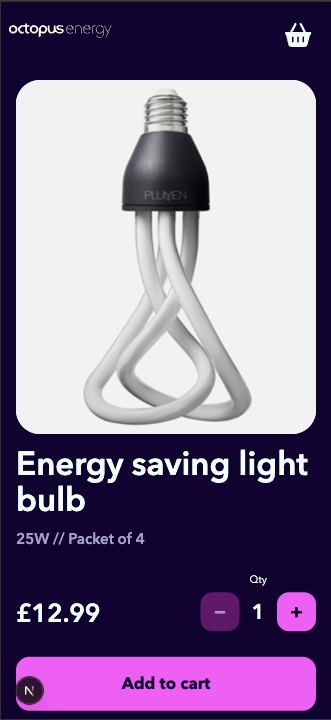
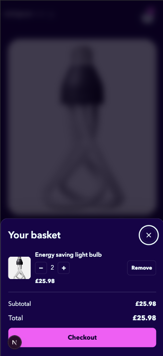
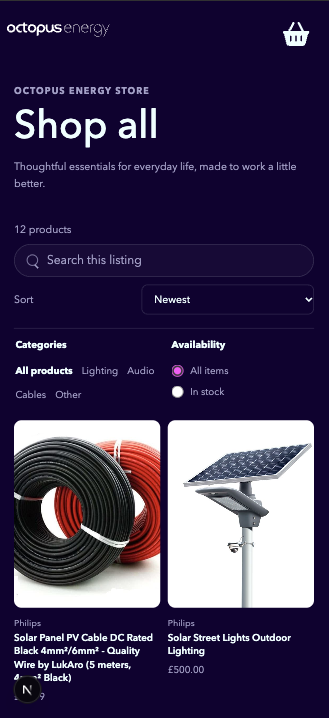
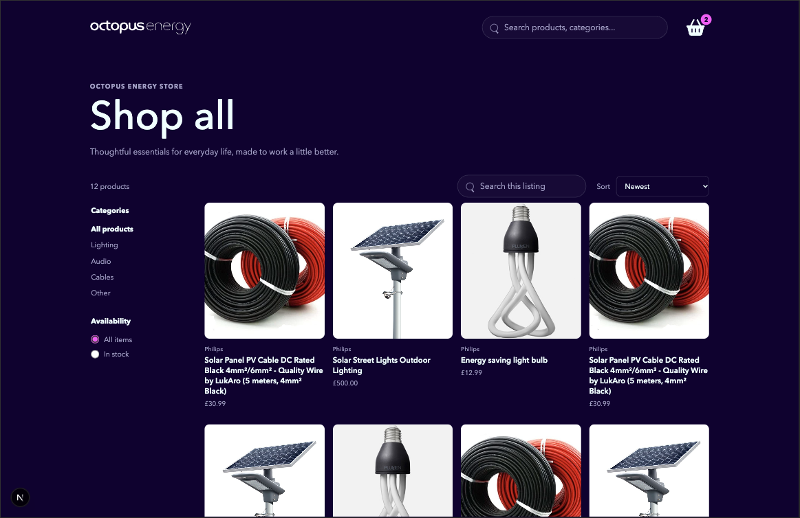
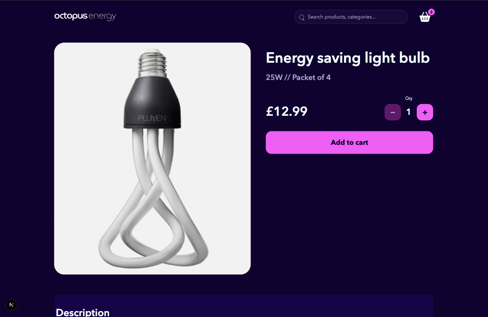
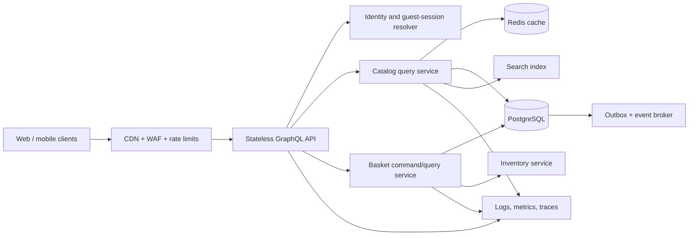

# Octopus Energy Store

A responsive product catalogue and product detail experience built with Next.js, React, and TypeScript. The frontend consumes the supplied GraphQL product stub. The basket UI is client-side state for this exercise; no production basket API or persistence was implemented.

## Screenshots

| View | Screenshot |
| --- | --- |
| Mobile product page |  |
| Mobile basket drawer |  |
| Mobile catalogue |  |
| Desktop catalogue |  |
| Desktop product page |  |

## Delivered

- Catalogue: product search, category filtering, in-stock filtering, and 3 sort modes (newest, price ascending, price descending).
- Product page: product information, stock-bounded quantity selection, and add-to-basket feedback.
- Basket: responsive side drawer on tablet/desktop and bottom sheet on mobile; supports quantity changes and removal, with live item count, line subtotals, basket subtotal, and total. Checkout is intentionally a no-op.
- Accessibility and resilience: semantic controls, keyboard-operable modal behavior, focus handling, Escape/backdrop dismissal, and product-image fallback.
- Tests: Vitest, Testing Library, and MSW cover catalogue filtering, product interactions, and basket behavior.

## Run Locally

Requirements: Node.js compatible with the installed Next.js version and pnpm 10.

```sh
cd client
pnpm install
pnpm dev
```

The app runs at [http://localhost:3000](http://localhost:3000); the provided product GraphQL stub runs at [http://localhost:3001/graphql](http://localhost:3001/graphql).

```sh
cd client
pnpm test
pnpm test:unit
pnpm test:integration
pnpm exec tsc --noEmit
pnpm build
```

Browser end-to-end tests use Playwright and start the Next app and GraphQL stub automatically. Install Chromium once, then run:

```sh
cd client
pnpm exec playwright install chromium
pnpm test:e2e
```

## Design Process

Claude and GitHub Copilot helped generate the initial design direction. I treated that as a baseline, then refined and corrected UI mismatches against `design.jpg`, including responsive image framing, mobile spacing, basket layout, typography, and section backgrounds.

### Frontend tooling choices

- **Storybook:** gives reusable UI components an isolated, interactive development surface. Stories make visual states easier to review without navigating through the whole app, and provide a practical place to catch component-level regressions as the interface grows.
- **Language dictionary (`client/lang/en.json`):** keeps user-facing copy out of component markup and gives `getMessage` a typed key/value interface. Adding another locale becomes a dictionary and locale-selection change rather than a component rewrite. The current app ships English only; language switching is not implemented.
- **MSW:** intercepts the GraphQL product request in tests and returns deterministic fixtures. This lets tests cover success, empty, and error responses without requiring a live server, while the same product fixtures can be reused by component stories.
- **Vitest and Testing Library:** exercise visible user behavior and accessible controls rather than implementation details.

## Backend Design: Proposed, Not Implemented

The current `server/db.js` is a generic product fixture served by the supplied stub; I did not implement or modify the backend. For production, I would separate the stateless GraphQL edge from domain services and persist baskets in a transactional relational database. Product reads and basket writes have different scaling and consistency needs, so they should not share one generic CRUD path.

### Component-level design



- **Edge and API:** terminate TLS, filter abusive traffic, authenticate requests, enforce GraphQL depth/complexity and time limits, and route to stateless API instances that scale horizontally.
- **Catalog service:** handles public product search/filter/sort. Cache suitable reads at the CDN or Redis with explicit invalidation; use a search index for text search at scale. Cache is an optimization, never the source of price or stock truth.
- **Basket service:** resolves the caller's account basket or an unguessable guest basket token. It validates commands and owns basket persistence, line pricing snapshots, and server-calculated totals. Private basket responses are not shared-cacheable.
- **PostgreSQL:** source of truth for basket ownership, version, lines, and prices used for the current basket. Commit basket changes transactionally; use version checks for concurrent edits and an outbox for reliable asynchronous events.
- **Inventory and checkout boundary:** basket updates validate current availability but do not promise stock. A future checkout flow revalidates and reserves inventory atomically with an idempotent order operation; payment and order fulfillment are separate services.
- **Operations:** instrument edge, API, database, and service boundaries with correlated traces, latency/error/saturation metrics, dashboards, alerts, and tested recovery procedures.

### GraphQL contract outline

This outline is proposed, not a deployed schema. `basket` is resolved from the authenticated principal or a server-issued guest token; callers never pass an arbitrary owner ID. The browser sends IDs and quantities, never authoritative prices.

```graphql
# Opaque keyset cursor; page size is bounded by the API (default 24, maximum 50).
scalar Cursor

# Integer minor currency units, such as pence; avoids floating-point money.
scalar MoneyMinor

type Query {
	# Browse products using stable cursor pagination and the selected filters/order.
	products(first: Int = 24, after: Cursor, sort: ProductSort = NEWEST,
					 category: String, inStockOnly: Boolean = false, search: String): ProductConnection!
	# Fetch the caller's basket; identity comes from auth/session context.
	basket: Basket!
}

type Mutation {
	# Add or merge a product line; idempotencyKey makes network retries safe.
	addBasketItem(input: AddBasketItemInput!): BasketPayload!
	# Set a line quantity; expectedVersion detects a concurrent basket edit.
	updateBasketItem(input: UpdateBasketItemInput!): BasketPayload!
	# Remove a line; expectedVersion prevents silently overwriting newer changes.
	removeBasketItem(input: RemoveBasketItemInput!): BasketPayload!
}

# Supported deterministic catalogue ordering; each order includes an ID tie-breaker.
enum ProductSort { NEWEST PRICE_ASC PRICE_DESC }

# Relay-style connection keeps each catalogue response bounded and pageable.
type ProductConnection {
	edges: [ProductEdge!]!
	pageInfo: PageInfo!
}
# One product and its opaque position in the ordered result set.
type ProductEdge { cursor: Cursor!, node: Product! }
# Indicates whether another page exists and supplies its continuation cursor.
type PageInfo { hasNextPage: Boolean!, endCursor: Cursor }

# Public catalogue fields; stock is advisory and is revalidated on writes/checkout.
type Product {
	id: ID!
	name: String!
	priceMinor: MoneyMinor!
	currency: String!
	availableQuantity: Int!
	imgUrl: String
}

# Server-computed amounts; discounts/shipping/tax can be zero or policy-derived.
type Basket {
	id: ID!
	version: Int!
	items: [BasketItem!]!
	subtotalMinor: MoneyMinor!
	discountMinor: MoneyMinor!
	shippingMinor: MoneyMinor!
	totalMinor: MoneyMinor!
	currency: String!
}
# unitPriceMinor is server-owned; lineSubtotalMinor is quantity x unit price.
type BasketItem {
	id: ID!
	product: Product!
	quantity: Int!
	unitPriceMinor: MoneyMinor!
	lineSubtotalMinor: MoneyMinor!
}
# Return validation/conflict errors as typed data alongside the latest basket.
type BasketPayload { basket: Basket, userErrors: [UserError!]! }
# Stable machine-readable error code plus a user-safe message and optional input field.
type UserError { code: String!, message: String!, field: String }

# Add requires a positive quantity and a unique key per logical client action.
input AddBasketItemInput {
	productId: ID!
	quantity: Int!
	idempotencyKey: ID!
}
# Quantities are absolute values, not deltas; version enables optimistic concurrency.
input UpdateBasketItemInput {
	itemId: ID!
	quantity: Int!
	expectedVersion: Int!
}
# Remove one basket line, with the same concurrency protection as update.
input RemoveBasketItemInput { itemId: ID!, expectedVersion: Int! }
```

### Responsibilities and high-traffic plan

- **Validation and totals:** mutations reject non-positive quantities, unavailable products, and quantities above current stock. Updates use the basket version for optimistic concurrency. Add operations use an idempotency key. The server owns unit price, promotions, shipping, tax, and totals; clients never submit trusted prices. Inventory is revalidated and reserved atomically at checkout, not by trusting a previously rendered basket.
- **Persistence:** store basket ownership/version and item/product/quantity rows in PostgreSQL. Update basket and items in one transaction; use row/version checks to prevent lost updates. Keep Redis as an optional cache for hot product reads or short-lived guest-session lookup, not as the source of truth for money or inventory.
- **Product pagination:** use cursor-based keyset pagination, not `OFFSET`, with a default of 24 and a hard maximum of 50 products per page. Cursors encode the selected sort key plus a unique ID tie-breaker (for example `(price, id)`), and are bound to the active filter/sort. This avoids deep-offset scans and unstable pages as the catalogue changes. Add composite indexes for supported sort orders, index filter fields, and use a search index for text search as catalogue volume grows. Keep responses bounded and query depth/complexity limited.
- **Read and write scaling:** serve public product pages through CDN/short-lived cache with explicit invalidation on catalog or stock changes. Do not shared-cache private basket responses. Scale stateless GraphQL instances horizontally; use database connection pooling, query timeouts, bounded batching/DataLoader to avoid N+1 reads, and measured indexes. Keep basket writes transactional and use an outbox for downstream events rather than synchronous fan-out.
- **Security:** authenticate account baskets; use unguessable, rotated guest tokens for anonymous baskets; authorize every basket read/write. Apply TLS, input limits, GraphQL depth/complexity limits, persisted operations where practical, and per-identity/IP rate limits. Avoid logging tokens or personal data. Apply CSRF protection when cookie authentication is used.

### Projected non-functional targets

These are initial planning targets, not measured results or guarantees. Validate them with production-like load tests and revise against real traffic and cost data.

| Area | Initial target / assumption |
| --- | --- |
| Capacity envelope | 100,000 daily active users; peak 2,000 product-read requests/s and 200 basket mutations/s; sustain 2x peak for 15 minutes during load tests. |
| Latency | Product connection p95 <= 200 ms and p99 <= 500 ms; basket read/mutation p95 <= 300 ms and p99 <= 800 ms, excluding client network time. |
| Availability | 99.95% monthly API availability (about 22 minutes monthly error budget); multi-zone database and application deployment. |
| Correctness | No negative quantities or client-authoritative totals; zero lost updates under version conflicts; idempotent retries produce one logical add. |
| Recovery | RPO <= 5 minutes and RTO <= 30 minutes for basket/catalogue data, verified through scheduled restore and failover exercises. |
| Operations | Trace and correlate requests by operation; alert on p95/p99 latency, 5xx rate, DB saturation, queue lag, and inventory conflicts. Page on sustained 5xx > 1% for 5 minutes or SLO burn; retain dashboards and runbooks. |

## Scope Notes

This submission demonstrates the frontend and documents a production backend design. The supplied stub does not provide basket persistence, inventory reservation, authentication, checkout, or production performance measurements. The projected targets above must not be interpreted as properties of the current demo.
